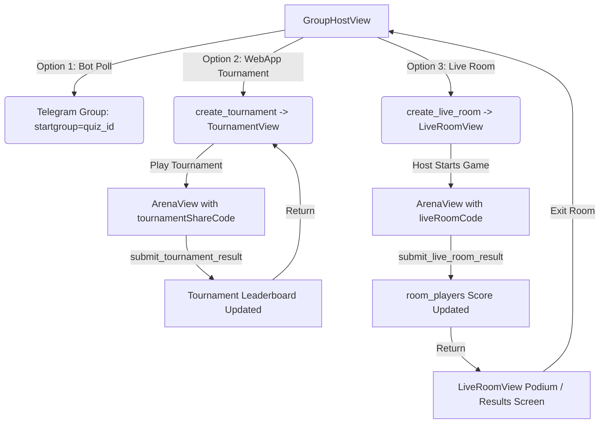

# Design Specification: WebApp Group Host, Tournament & Live Room Complete Fixes

**Date:** 2026-10-13  
**Status:** Draft / Ready for Review  
**Author:** AI Agent & Islombek  
**Target:** `Queasy_uz_Bot` WebApp & Telegram Serverless Cloud

---

## 1. Overview & Problem Statement

The WebApp's Group Hosting system provides three distinct ways for users and communities to play quizzes together:
1. **Telegram Native Polls (Bot):** The bot is invited to a Telegram group chat and sends questions sequentially as native Telegram Quiz Polls.
2. **Group Tournaments (WebApp):** Asynchronous group competition where members solve the quiz independently in the WebApp and compete on a shared real-time group leaderboard.
3. **Live Multiplayer Rooms (Kahoot Style):** Synchronous real-time game where a host creates a 6-digit PIN room, players join the lobby, and the game is started simultaneously.

### Identified Critical Bugs & Defects:
1. **Live Room Infinite Re-launch Trap:** When a game starts, `App.jsx` sets `activeQuizId` but leaves `activeRoomCode` set. When the user finishes or exits the quiz in `ArenaView`, `App.jsx` resets `activeQuizId` to `null` and re-renders `LiveRoomView`. Because the room status on the server is still `active`, `LiveRoomView` immediately calls `onStartGame` again, trapping both host and players in an inescapable loop.
2. **Missing Live Room Score Submission:** `ArenaView` only submits to `submitTournamentResult` or `submitSoloResult`. No score submission for live rooms exists on frontend or backend, causing all `roomPlayers.score` to permanently remain `0`.
3. **Missing Live Room Podium / Leaderboard View:** `LiveRoomView` only has a `waiting` (Lobby) state. It lacks a results/podium screen showing 1st, 2nd, and 3rd place winners when the quiz finishes.
4. **Empty Quizzes for Non-Author Users:** `get_group_sessions.js` queries `quizzes.ownerId === currentUserId`. For students and general users who have not authored custom quizzes, the launchable list is completely empty `[]`, ignoring all public and KIUT system quizzes (`ownerId = 0`).
5. **Dead Code in `GroupHostView.jsx`:** `handleLaunchInGroup(shareLink)` was written to launch the native Telegram Bot Poll (`startgroup=quiz_${id}`), but is not connected to any UI button.
6. **Hardcoded Uzbek Text & Broken Localization:** Over 25 UI labels, alerts, button titles, and error messages in `GroupHostView.jsx`, `LiveRoomView.jsx`, and `TournamentView.jsx` are hardcoded in Uzbek rather than using `t(...)` from `uz.js` and `ru.js`.
7. **No Actionable Empty State:** `GroupHostView` lacks CTA buttons to create a quiz in Quiz Creator or pick a quiz from KIUT catalog when `launchableQuizzes` is empty.
8. **Guest ID Collision in Tournament:** `p.userId === userId` matches multiple unauthenticated guest users with `userId: 0`, leading to incorrect ranking for guests.

---

## 2. Architecture & Data Flow



---

## 3. Detailed Component & Endpoint Specifications

### 3.1. Backend Endpoints (`tgcloud/endpoints/`)

#### 3.1.1. `tgcloud/endpoints/submit_live_room_result.js` (NEW)
- **Method / Payload:**
  - `input.roomCode`: string (6-digit PIN)
  - `input.score`: number (correct questions count)
  - `input.totalQuestions`: number
  - `input.totalTimeSeconds`: number
- **Logic:**
  1. Validate `roomCode`. Check that `liveRooms` exists with this code.
  2. Extract `callerId` from `ctx?.initData?.user?.id` or `0`.
  3. Determine `userName` from `ctx?.initData?.user` or fallback to `'O\'yinchi'`.
  4. Find player in `roomPlayers` matching `roomCode` and `userId = callerId` (or matching `userName` if `callerId === 0`).
  5. If found, update `roomPlayers` set `score = input.score`, `finishedAt = unixepoch()`.
  6. If not found, insert into `roomPlayers`.
  7. Return `{ success: true, rank, score, totalQuestions, totalPlayers }`.

#### 3.1.2. `tgcloud/endpoints/finish_live_room.js` (NEW)
- **Method / Payload:**
  - `input.roomCode`: string
- **Logic:**
  1. Fetch room from `liveRooms` by `roomCode`.
  2. Verify that `ctx?.initData?.user?.id === room.hostId` (only host can officially finish/close the room).
  3. Update `liveRooms` set `status = 'finished'`.
  4. Return `{ success: true, status: 'finished' }`.

#### 3.1.3. `tgcloud/endpoints/get_live_room_state.js` (UPDATED)
- **Updates:**
  - Include `hasFinished`: boolean for `currentUserId` based on whether `finishedAt` is populated in `roomPlayers`.
  - Include sorted `leaderboard`: list of all players ordered by `score DESC, joinedAt ASC`.
  - Return room `status`: `'waiting' | 'active' | 'finished'`.

#### 3.1.4. `tgcloud/endpoints/get_group_sessions.js` (UPDATED)
- **Updates:**
  - Fetch user's quizzes first (`ownerId = currentUserId`).
  - If user has fewer than 5 quizzes, fetch public/catalog quizzes (`ownerId = 0`) to populate `launchableQuizzes` (up to 10 total).
  - Add `isPublic: boolean` flag so the UI can badge them ("Mening testim" vs "Umumiy test").
  - Ensure every quiz provides:
    - `id`, `title`, `description`, `questionCount`, `timeLimit`, `isPublic`
    - `shareLink`: `https://t.me/Queasy_uz_Bot?startgroup=quiz_${q.id}`

---

### 3.2. Frontend Service & Constants (`src/services/` & `src/constants/`)

#### 3.2.1. `src/constants/endpoints.js`
Add:
```javascript
export const EP_SUBMIT_LIVE_ROOM_RESULT = 'submit_live_room_result';
export const EP_FINISH_LIVE_ROOM = 'finish_live_room';
```

#### 3.2.2. `src/services/quizService.js`
Add:
```javascript
export async function submitLiveRoomResult(payload) {
  return await callEndpoint(EP_SUBMIT_LIVE_ROOM_RESULT, payload);
}

export async function finishLiveRoom(roomCode) {
  return await callEndpoint(EP_FINISH_LIVE_ROOM, { roomCode });
}
```

---

### 3.3. View Refactoring

#### 3.3.1. `src/App.jsx`
- Introduce `activeLiveRoomCode` state alongside `activeTournamentCode`.
- When `LiveRoomView` calls `onStartGame(quizId, roomCode)`:
  - Set `setActiveQuizId(quizId)`.
  - Set `setActiveLiveRoomCode(roomCode)`.
- Pass `liveRoomCode={activeLiveRoomCode}` into `<ArenaView />`.
- When exiting ArenaView (`handleExitArena`):
  - Reset `setActiveQuizId(null)`.
  - Keep `activeLiveRoomCode` so user seamlessly transitions back to `LiveRoomView` to view the **Results / Podium Leaderboard**.
  - When user leaves `LiveRoomView` (`onBack`), set `setActiveLiveRoomCode(null)` and `setActiveRoomCode(null)`.

#### 3.3.2. `src/views/ArenaView.jsx`
- Add prop `liveRoomCode = null`.
- In `handleAdvance()` on final question:
  ```javascript
  if (tournamentShareCode) {
    submitTournamentResult(...);
  } else if (liveRoomCode) {
    submitLiveRoomResult({
      roomCode: liveRoomCode,
      score: finalCorrect,
      totalQuestions: questions.length,
      totalTimeSeconds: elapsed,
    });
  } else {
    submitSoloResult(...);
  }
  ```
- In `ResultCard`: if `liveRoomCode` is present, display Live Room badge and button to "Jonli Xona Natijalariga Qaytish" (calls `onBackHome`).

#### 3.3.3. `src/views/LiveRoomView.jsx`
- Introduce 3 UI states:
  1. **LOBBY (`status === 'waiting'`):**
     - PIN code display, Telegram share button, copy link button.
     - Waiting room players grid.
     - Host "O'yinni Boshlash" button; player "Kuting..." card.
  2. **GAME IN PROGRESS (`status === 'active'` && user hasn't finished):**
     - Polling triggers `onStartGame`.
  3. **PODIUM / RESULTS (`status === 'finished'` OR user has finished their attempt):**
     - Gold/Silver/Bronze trophy podium cards for top 3 players.
     - Full participants list with scores and times.
     - If Host: button "Xonani yakunlash" (`finishLiveRoom`).
     - Button "Xonadan chiqish" (`onBack`) to return cleanly to Home / Group Host.
- Eliminate infinite loop: do NOT trigger `onStartGame` if `roomData.hasFinished` is true.

#### 3.3.4. `src/views/GroupHostView.jsx`
- Wire all 3 launch options in the action bar:
  1. **🤖 Bot Polli:** `handleLaunchInGroup(q.shareLink)` opens Telegram group picker to invite bot and launch native poll.
  2. **🏆 Guruh Turniri:** `handleShareTournament(q.id)` opens tournament share modal.
  3. **⚡ Jonli Xona:** `handleCreateLiveRoom(q.id)` creates Kahoot-style room.
- Render quiz description on card expand.
- If `launchableQuizzes` is empty: provide 2 CTA buttons:
  - `onOpenCreator`: "Yangi test yaratish"
  - `onOpenKiut`: "KIUT testlaridan tanlash"
- Pass `onOpenCreator` and `onOpenKiut` from `App.jsx`.

#### 3.3.5. `src/views/TournamentView.jsx`
- Fix tie-breaking and guest ranking issues.
- Localize all static Uzbek strings via `t(...)`.

---

### 3.4. Localization (`src/i18n/locales/`)
Add and update keys in `uz.js` and `ru.js`:
- `BTN_LAUNCH_BOT_POLL`: 'Bot orqali o\'tkazish' / 'Через бота (Опрос)'
- `BTN_GROUP_TOURNAMENT`: 'Guruh turniri' / 'Турнир группы'
- `BTN_LIVE_ROOM`: 'Jonli xona' / 'Комната онлайн'
- `LIVE_ROOM_PIN_LABEL`: 'Xona PIN kodi' / 'PIN-код комнаты'
- `LIVE_ROOM_INVITE_GROUP`: 'Guruhga taklif qilish' / 'Пригласить в группу'
- `LIVE_ROOM_LOBBY_TITLE`: 'Kutish zali' / 'Комната ожидания'
- `LIVE_ROOM_WAITING_HOST`: 'Boshlovchi o\'yinni boshlashini kuting...' / 'Ожидайте начала от ведущего...'
- `LIVE_ROOM_PODIUM_TITLE`: 'Jonli Xona Natijalari' / 'Результаты комнаты'
- `LIVE_ROOM_EXIT`: 'Xonadan chiqish' / 'Выйти из комнаты'
- `LIVE_ROOM_FINISH_BTN`: 'Xonani yakunlash' / 'Завершить комнату'
- `GROUP_CHOOSE_CATALOG`: 'KIUT katalogidan tanlash' / 'Выбрать из каталога KIUT'
- `GROUP_CREATE_NEW_QUIZ`: 'Yangi test yaratish' / 'Создать новый тест'

---

## 4. Verification Plan

1. **Unit & Logic Tests (`tests/test_group_live_endpoints.mjs`):**
   - Test `submit_live_room_result` updates `roomPlayers.score` correctly.
   - Test `finish_live_room` ensures only host can mark room as finished.
   - Test `get_group_sessions` returns public quizzes if user has 0 quizzes.
   - Test `get_live_room_state` accurately returns `hasFinished` and sorted leaderboard.
2. **Build Validation:**
   - Run `npm run build` to verify clean Vite build without chunk size issues or missing imports.
3. **Knowledge Graph Update:**
   - Run `graphify update .` to ensure AST knowledge graph remains current.
