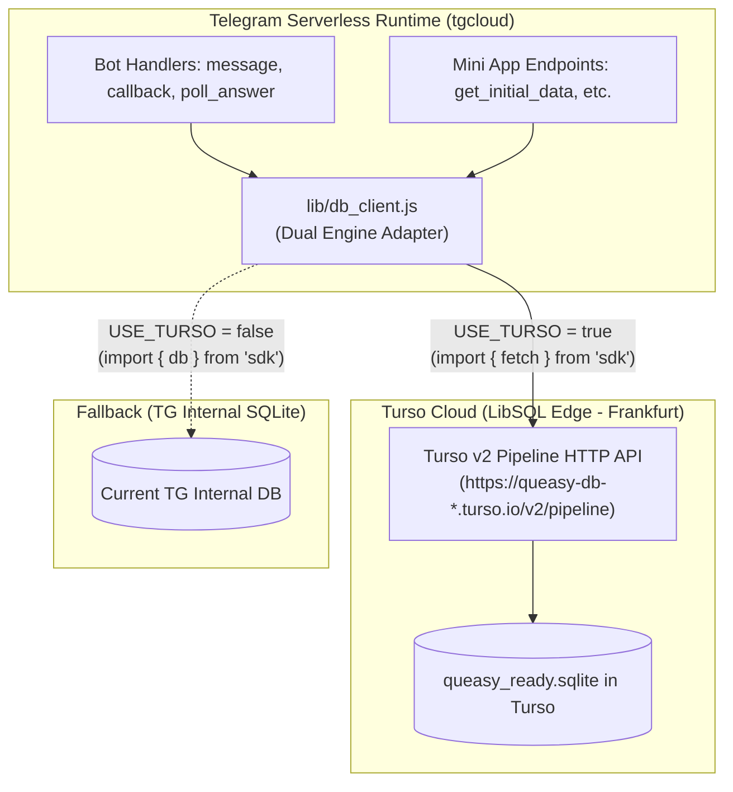

# Turso Cloud (LibSQL) Migration Design Specification

- **Date:** 2026-10-17
- **Author:** Antigravity & Islombek
- **Target Project:** Queasy_uz_Bot (Telegram Serverless Bot & Mini App)
- **Status:** Draft / Ready for Implementation

---

## 1. Executive Summary & Problem Statement

### 1.1 The Problem
Under increased user traffic, Telegram Serverless's internal SQLite database experienced concurrency locking (`SQLITE_BUSY` / unrecoverable state). Because SQLite is an embedded single-writer database on a local virtual disk, concurrent writes from parallel serverless invocations (such as simultaneous `poll_answer` events or `UPDATE users SET last_active_at = ...`) caused the runtime database connection to lock up.

### 1.2 The Solution
Migrate to **Turso Cloud (LibSQL)**:
- **Rust-powered daemon (`sqld`)** handles write concurrency in an in-memory queue without OS file-level locks.
- **Edge-hosted LibSQL engine** allows non-blocking concurrent reads and microsecond write transactions.
- **5 GB Free Storage & 10M Writes / Month** provides 100x the capacity needed for the current 80,000+ questions and 102 users.
- **Zero-downtime & Safe Rollback**: Current Telegram Cloud data remains completely untouched. A dual-mode adapter allows instant rollback if desired.

---

## 2. Architecture & Data Flow

---

## 3. The 16 Tables to Migrate

All 16 tables from `tgcloud/schema.js` will be preserved with exact schema, primary keys, and indexes:

1. `users` (102 records)
2. `groups` (4 records)
3. `quizzes` (2,794 records)
4. `questions` (848,845 records)
5. `user_mistakes` (1,541 records)
6. `quiz_sessions` (261 records)
7. `group_answers` (611 records)
8. `required_channels` (0 records)
9. `user_states` (83 records)
10. `bot_settings` (5 records)
11. `group_lobbies` (44 records)
12. `categories` (639 records)
13. `group_tournaments` (36 records)
14. `tournament_participants` (2 records)
15. `live_rooms` (25 records)
16. `room_players` (26 records)

---

## 4. Phase-by-Phase Implementation Plan

### Phase 1: Local SQLite File Generation (`queasy_ready.sqlite`)
1. Create a Python/Node migration generator `scripts/build_full_sqlite_db.py`.
2. Connect to TGCloud via `runFunction` to dump the live records for all dynamic tables (`users`, `quizzes`, `categories`, `user_mistakes`, `quiz_sessions`, `group_answers`, `group_tournaments`, `live_rooms`, `room_players`, `group_lobbies`, `groups`, `user_states`, `bot_settings`, `tournament_participants`).
3. Populate `questions` table either directly from the parsed docx dataset or TGCloud database.
4. Verify table integrity, record counts, and build proper SQLite indexes (`idx_questions_quiz_id`, `idx_quizzes_category`, `idx_users_created_at`, etc.).
5. Produce `d:/Serverless/Queasy_uz_Bot/queasy_ready.sqlite`.

### Phase 2: Turso Database Initialization
1. User uploads `queasy_ready.sqlite` to Turso via the web console (`app.turso.tech`) using **"Upload SQLite File"**.
2. Location chosen: **Frankfurt (`fra`)** or **Amsterdam (`ams`)** for lowest latency to Telegram Europe nodes.
3. User creates an Auth Token and copies `TURSO_DATABASE_URL` and `TURSO_AUTH_TOKEN`.
4. Run a verification script `scripts/verify_turso_connection.mjs` to execute `SELECT count(*) FROM questions` and `SELECT count(*) FROM users` against the Turso HTTP API to verify 100% data fidelity.

### Phase 3: High-Performance Turso Client for Telegram Serverless
1. Create `tgcloud/lib/turso_client.js`:
   - Uses `import { fetch } from 'sdk'` (zero npm dependencies).
   - Supports single query execution and batch pipeline execution (`/v2/pipeline`).
   - Methods: `query(sql, params)`, `get(sql, params)`, `all(sql, params)`, `run(sql, params)`.
2. Configure environment credentials in `tgcloud/lib/constants/config.js` (`TURSO_URL`, `TURSO_TOKEN`, `USE_TURSO`).

### Phase 4: Service Layer Integration & Verification
1. Update services to use the database client (`user_service.js`, `quiz_service.js`, `session_service.js`, `group_service.js`, `admin_service.js`).
2. Test end-to-end:
   - Run `/start` message handler test.
   - Run WebApp `get_initial_data` test.
   - Run Quiz attempt and live poll answer test.
3. Build Mini App (`npm run build`) and deploy (`npx @tgcloud/cli push`).

---

## 5. Risk Assessment & Mitigations

| Risk | Impact | Mitigation |
| :--- | :--- | :--- |
| **Network latency over HTTP** | +20-30ms per request | Batch queries where possible (`/v2/pipeline`), user cannot perceive 25ms. |
| **Turso rate limits** | Low (10M writes / 500M reads) | Free quota exceeds current bot usage by 100x. |
| **Unexpected syntax mismatch** | Low | Turso runs LibSQL (SQLite fork); 100% syntax and type parity. |
| **Rollback need** | Low | Set `USE_TURSO = false` in config to instantly revert to local TG database. |

---

## 6. Acceptance Criteria
- [ ] `queasy_ready.sqlite` generated locally with all 16 tables and verified row counts.
- [ ] Database uploaded and live on Turso Cloud in Frankfurt (`fra`).
- [ ] `verify_turso_connection.mjs` passes and returns matching row counts.
- [ ] Bot handlers and WebApp endpoints respond within <150ms using Turso.
- [ ] Concurrency load test (simulated parallel answers) executes with 0 `SQLITE_BUSY` errors.
