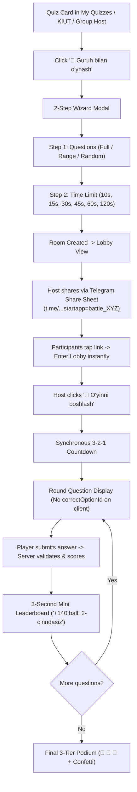

# Design Specification: Simplified Group Live Battle & 2-Step Quiz Wizard

**Date:** 2026-11-14  
**Project:** Queasy Bot (`d:\Serverless\Queasy_uz_Bot`)  
**Status:** Draft / Proposed  
**Author:** Antigravity & User  

---

## 1. Executive Summary

### 1.1 Problem Statement
Currently, Queasy Bot's group quiz feature inside the WebApp is fragmented and complex:
1. **Mode Confusion:** In `GroupHostView.jsx`, each quiz card renders three different, confusing action buttons:
   - *«Bot orqali boshlash»* (starts a Telegram group poll via deep-link)
   - *«Guruh turniri»* (asynchronous tournament mode)
   - *«Jonli xona»* (synchronous live room)
2. **Friction in Joining:** Users must deal with 6-digit PIN codes that require manual typing or error-prone copy-pasting.
3. **Cheat Vulnerability:** Quizzes currently load all questions with `correctOptionId` in one batch to the client, allowing tech-savvy players to inspect answers via DevTools.
4. **Rigid Time Limits:** While question count is selectable, question time limits are fixed to the quiz default and cannot be customized by the host.

### 1.2 Proposed Solution
1. **Single Group Mode — «Guruh bilan o'ynash» (Live Battle):** Eliminate mode confusion by offering one primary, synchronized, competitive multiplayer battle inspired by Kahoot and Quizizz.
2. **Zero-PIN Telegram Deep Linking:** Replace manual PIN entry with direct Telegram links (`https://t.me/Queasy_uz_Bot/app?startapp=battle_<roomCode>`). One tap enters the lobby immediately.
3. **2-Step Wizard Modal:**
   - **Step 1 (Question Count):** Full (auto-advances to Step 2), Range, or Random.
   - **Step 2 (Time Limit):** Standard presets matching the Telegram bot (`10s`, `15s`, `30s`, `45s`, `1m (60s)`, `2m (120s)`) plus custom second input.
4. **Server-Authoritative Anti-Cheat & Scoring:** Deliver questions round-by-round *without* `correctOptionId`. Validate answers server-side with speed bonus scoring:
   $$\text{Score} = 100 + \left( \frac{\text{remainingTime}}{\text{totalTime}} \times 50 \right)$$
5. **Synchronous Gameplay Flow:** 3-2-1 countdown $\rightarrow$ synchronized round $\rightarrow$ 3-second intermediate leaderboard $\rightarrow$ next round $\rightarrow$ final celebratory 3-tier Podium.

---

## 2. End-to-End User Experience & Flow



### 2.1 Step 1: Entry & 2-Step Wizard Modal (`QuizModeModal.jsx`)
- **Step 1 (Question Scope):**
  - **To'liq rejim (Full):** Tapping this immediately auto-advances to Step 2 without needing an extra click.
  - **Oraliq (Range):** Displays preset pills (`1–25`, `26–50`, etc.) and manual inputs (`Start` — `End`), with a «Keyingisi ➡️» button.
  - **Tasodifiy (Random):** Displays preset pills (`10`, `15`, `20`, `30`, `50`) and manual input, with a «Keyingisi ➡️» button.
- **Step 2 (Time Limit per Question):**
  - Header: Shows selected quiz title, question count, and a back button (`⬅️`) to return to Step 1.
  - Preset Grid:
    - Row 1: `10 soniya` • `15 soniya` • `30 soniya`
    - Row 2: `45 soniya` • `1 daqiqa (60s)` • `2 daqiqa (120s)`
  - Manual Input: Optional field for custom duration in seconds.
  - Primary Action: `«🚀 Xonani yaratish»` (creates the live room with full modeConfig).

### 2.2 Step 2: Friction-Free Lobby (`LiveRoomView.jsx`)
- Zero PIN input needed.
- Quiz Title, question count, and time limit summary badge.
- Primary Share Button: `«✈️ Do'stlarni taklif qilish»`
  - Opens Telegram share dialog: `https://t.me/share/url?url=...&text=...`
  - URL format: `https://t.me/Queasy_uz_Bot/app?startapp=battle_<roomCode>`
- Live Player Roster: Displays joined players with avatars, names, and host indicator.
- Host Control: `«🚀 O'yinni boshlash (N ta o'yinchi)»` button (disabled if 0 additional players or host is ready).
- Non-host view: Friendly waiting state: *"Xona egasi o'yinni boshlashini kutyapmiz..."*.

### 2.3 Step 3: Synchronized Battle Arena
- **Countdown:** 3-2-1 full-screen visual and haptic countdown.
- **Round Question:**
  - Round indicator: `Savol 1 / 15`.
  - Animated circular or linear countdown timer based on the host's configured time limit.
  - Question text, optional image, and 4 shuffled answer options.
  - **Anti-Cheat:** `correctOptionId` is omitted from the question payload.
- **Answer Submission:**
  - Once tapped, the selected option highlights, and the answer is sent to `/api/submit_live_answer`.
  - Server responds with `{ isCorrect: boolean, scoreDelta: number, currentTotalScore: number }`.
- **3-Second Intermediate Leaderboard:**
  - Revealing phase: Correct option highlights in green; if chosen wrong, the chosen option highlights in red.
  - Displays points gained for the question and current rank among players.
  - Auto-advances to next round when the 3 seconds elapse.

### 2.4 Step 4: Final 3-Tier Podium & Leaderboard
- Festive confetti animation (`canvas-confetti`).
- Visual 3D-style podium:
  - 🥇 1st Place (Center, tallest, Gold)
  - 🥈 2nd Place (Left, Silver)
  - 🥉 3rd Place (Right, Bronze)
- Complete participant ranking table below the podium.
- Action Buttons:
  - Host: `«🔄 Qaytadan o'ynash»` / `«🏠 Bosh sahifa»`
  - Participants: `«🏠 Bosh sahifa»`

---

## 3. Data Architecture & Database Schema

### 3.1 SQLite / Turso Schema Updates

```sql
-- Existing live_rooms table - enhanced usage
-- (id, room_code, quiz_id, host_id, status, current_question_index, created_at)
-- Added/tracked via modeConfig in bot_settings or column:
-- modeConfig: { mode: 'full'|'range'|'random', range: [1,25], randomCount: 20, timeLimit: 15 }

-- Live Room Question Answers (Per-question player tracking)
CREATE TABLE IF NOT EXISTS live_room_answers (
  id INTEGER PRIMARY KEY AUTOINCREMENT,
  room_code TEXT NOT NULL,
  user_id INTEGER NOT NULL,
  question_index INTEGER NOT NULL,
  selected_option_id INTEGER NOT NULL,
  is_correct INTEGER NOT NULL,
  score_awarded INTEGER NOT NULL DEFAULT 0,
  time_taken INTEGER NOT NULL DEFAULT 0,
  answered_at INTEGER DEFAULT (unixepoch())
);

CREATE INDEX IF NOT EXISTS idx_live_answers_room ON live_room_answers(room_code);
CREATE INDEX IF NOT EXISTS idx_live_answers_room_user ON live_room_answers(room_code, user_id);
```

### 3.2 Scoring Algorithm
For each question:
- Maximum base points for a correct answer: $P_{\text{base}} = 100$
- Maximum speed bonus: $P_{\text{speed}} = 50$
- Remaining time: $t_{\text{remaining}} = \max(0, T_{\text{total}} - t_{\text{taken}})$
- If correct:
  $$\text{ScoreAwarded} = 100 + \text{round}\left( 50 \times \frac{t_{\text{remaining}}}{T_{\text{total}}} \right)$$
- If incorrect or timed out: $\text{ScoreAwarded} = 0$.

---

## 4. API Endpoints Specification

### 4.1 `create_live_room.js`
- **Input:** `{ quizId: number, modeConfig: { mode, range, randomCount, timeLimit } }`
- **Logic:**
  1. Validates quiz existence and question count.
  2. Generates unique 6-digit alphanumeric or numeric `roomCode`.
  3. Inserts into `live_rooms` with `status: 'waiting'`.
  4. Stores `live_room_cfg:${roomCode}` with full `modeConfig` (including `timeLimit`).
  5. Inserts host into `room_players`.
- **Output:** `{ success: true, roomCode, shareLink }`

### 4.2 `get_live_room_state.js`
- **Input:** `{ roomCode: string }`
- **Logic:**
  1. Fetches room metadata, host ID, status (`waiting` | `active` | `finished`).
  2. If new user opens with valid Telegram auth, auto-joins them to `room_players`.
  3. Returns player roster sorted by score, total count, host indicator, and quiz details.
- **Output:** `{ success: true, room, quiz, players, isHost, modeConfig }`

### 4.3 `start_live_room.js`
- **Input:** `{ roomCode: string }`
- **Logic:**
  1. Verifies caller is host (`host_id === currentUserId`).
  2. Sets `live_rooms.status = 'active'`, `current_question_index = 0`.
  3. Sets `round_started_at = unixepoch()`.
- **Output:** `{ success: true, roomCode, status: 'active' }`

### 4.4 `get_live_question.js`
- **Input:** `{ roomCode: string, questionIndex: number }`
- **Logic:**
  1. Verifies caller is in `room_players`.
  2. Fetches the question for the given index based on `modeConfig`.
  3. **Security:** Excludes `correctOptionId` and `explanation`.
- **Output:**
  ```json
  {
    "success": true,
    "questionIndex": 0,
    "totalQuestions": 15,
    "timeLimit": 15,
    "question": {
      "id": 402,
      "questionText": "Beruniy qachon tug'ilgan?",
      "options": ["973-yil", "980-yil", "1048-yil", "960-yil"],
      "photoFileId": null
    }
  }
  ```

### 4.5 `submit_live_answer.js`
- **Input:** `{ roomCode: string, questionIndex: number, selectedOptionId: number, timeTaken: number }`
- **Logic:**
  1. Checks if player already answered this `questionIndex` (prevents double submits).
  2. Queries true `correct_option_id` from database.
  3. Computes score with speed bonus formula.
  4. Records in `live_room_answers` and increments `room_players.score`.
- **Output:**
  ```json
  {
    "success": true,
    "isCorrect": true,
    "correctOptionId": 0,
    "scoreAwarded": 142,
    "totalScore": 420
  }
  ```

---

## 5. Frontend View Consolidation

| Current File | Changes & Responsibilities |
| :--- | :--- |
| `src/components/quiz/QuizModeModal.jsx` | Refactored into 2-step Wizard: Step 1 (Scope) with Full auto-advance, Step 2 (Time Limit: `10s`, `15s`, `30s`, `45s`, `60s`, `120s`, manual). |
| `src/views/GroupHostView.jsx` | Simplified: Remove 3 confusing buttons (*Bot poll*, *Tournament*, *Live Room*). Replaced with single prominent `«👥 Guruh bilan o'ynash»` button. |
| `src/views/LiveRoomView.jsx` | Lobby and Podium coordinator. Clean Telegram link generation without PIN requirement. |
| `src/views/ArenaView.jsx` | Enhanced Live Battle Mode: Synchronous round progression, client countdown timer, intermediate 3s scoreboard, anti-cheat question fetching. |
| `src/App.jsx` | Updated deep link parser for `battle_<roomCode>` and route management. |

---

## 6. Edge Cases & Error Handling

1. **Host Disconnection:** If the host drops out of the lobby, room state remains active so host can re-enter. If after start, rounds progress on server time.
2. **Late Joiners:** Players opening the deep link after `status === 'active'` are gracefully shown a spectator or "O'yin allaqachon boshlangan" notice.
3. **Double Click / Re-entrancy:** `submit_live_answer` rejects multiple answer submissions for the same user and question index.
4. **Time Sync:** Question round timer is validated server-side based on round start time, preventing client timer manipulation.

---

## 7. Verification & Testing Strategy

1. **Unit & API Testing (`tests/endpoints/`):**
   - Test `create_live_room` with customized `timeLimit` in `modeConfig`.
   - Test `submit_live_answer` scoring algorithm (fast response $\approx 150$, slow response $\approx 100$, wrong $= 0$).
   - Test anti-cheat: ensure `get_live_question` never exposes `correctOptionId`.
2. **Full Regression Testing:**
   - Execute `npm test` to ensure all existing 23 test suites pass without regressions.
3. **End-to-End Simulation:**
   - Host creates a room with 15 questions and 15s timer.
   - Joiner connects via `battle_<roomCode>` link.
   - Verify lobby updates, 3-2-1 countdown, question presentation, intermediate scorecards, and final podium.
